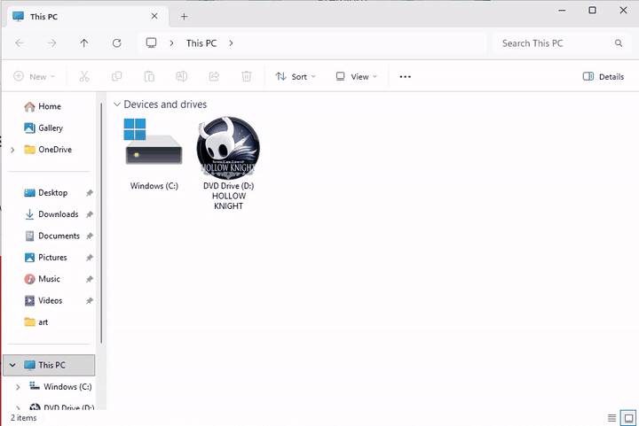
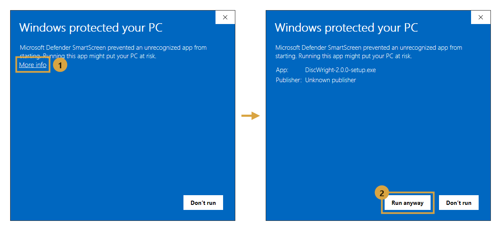
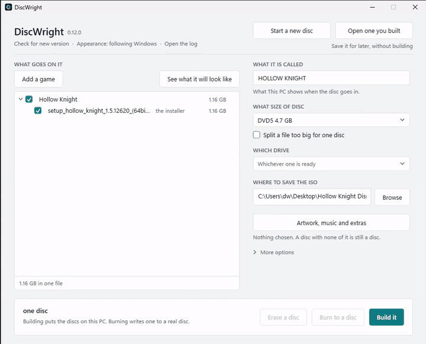
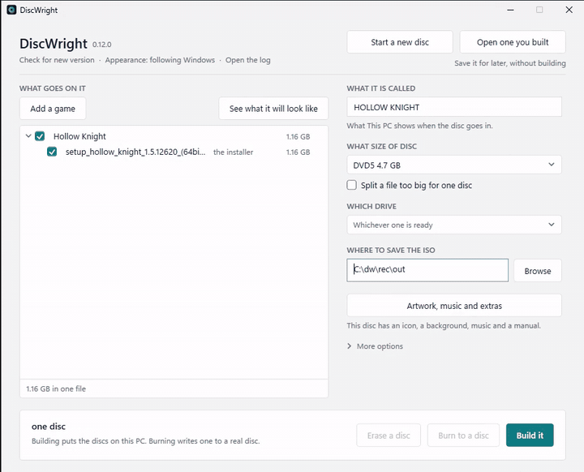
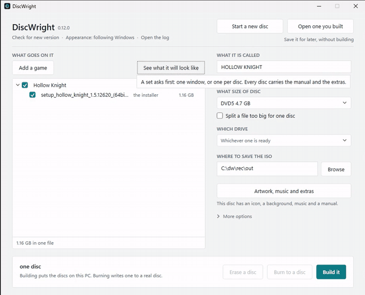
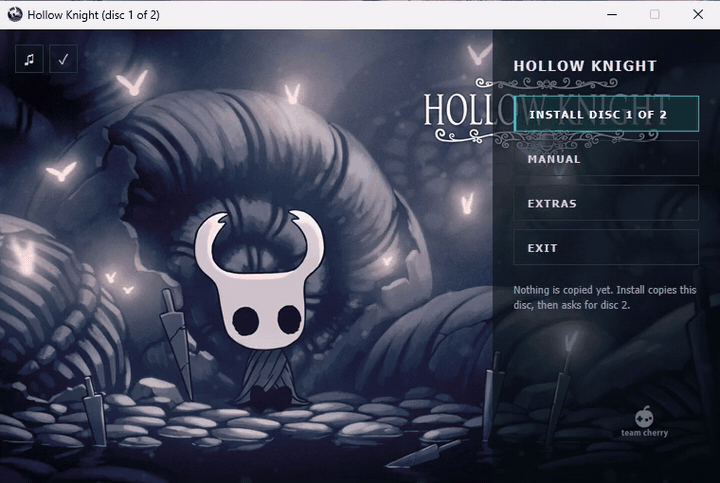
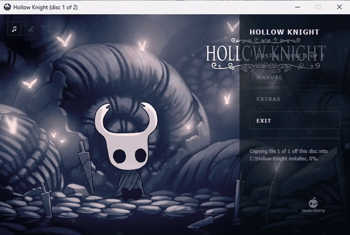

# DiscWright

Turn a GOG offline installer into a real game disc. It shows the game's own icon and name in This PC, opens a menu when it goes in, and installs the game years from now on a machine that has never heard of DiscWright. A game too big for one blank becomes a set of discs, and every disc is read back and checked after it is burned. It is not only for GOG: any folder of game files goes on a disc the same way.

The way PC games came in a box.



## Download

**[DiscWright 2.0.1 for Windows](../../releases/latest)**

- **`DiscWright-2.0.1-setup.exe`** installs it for your user only, with no administrator prompt, and adds it to the Start menu.
- **`DiscWright-2.0.1-portable.exe`** is the same app as one file. Put it anywhere and double-click it. Nothing is installed; like the installed app, it keeps its log in `%LOCALAPPDATA%\DiscWright`.

Windows 10 or 11, 64-bit. Everything the app needs is inside it; there is nothing else to install.

**Updating.** Press **Check for new version** under the app's name. When there is a newer one, the installed app offers **Update to** it: it downloads the release's installer, checks it against the checksum the release publishes, then closes, updates and opens again by itself. It only ever does that when you press it, and never while a disc is being built, burned or erased. The portable exe offers the release page instead, where you download the new one in place of the old. With winget, `winget upgrade DiscWright.DiscWright`.

**Already using the PowerShell DiscWright?** Installing 2.0 upgrades it in place, in the same Start menu entry and the same folder. Discs made with it work exactly as they did.

**Looking for the PowerShell version?** It is still maintained, on the [`powershell` branch](../../tree/powershell), and its releases are the [`v0.11.x` tags](../../releases). It installs beside this one and neither touches the other.

### What Windows is going to say

**"Windows protected your PC."** That is SmartScreen, on the first run of a program from the internet that is not code signed. DiscWright is not signed yet. **More info, then Run anyway.**



**On some new Windows 11 machines it will not start at all.** Smart App Control, on by default after a clean install of Windows 11 22H2 or later, refuses unsigned programs outright: "An Application Control policy has blocked this file". Signing is what fixes that properly, and it is planned. Until then the setting lives under **Windows Security, App and browser control, Smart App Control**, and [Microsoft's page](https://learn.microsoft.com/en-us/windows/apps/develop/smart-app-control/overview) explains what turning it off means.

## Why

GOG sells DRM-free installers. You own them outright, you can back them up, and they never need the internet to install. But they sit in a folder called `setup_alan_wake_1.1_music_lang_fix_(80728).exe`, and that is not quite the same as a shelf.

Burn one with any normal ISO tool and Windows shows you `DVD RW Drive (E:)`. Burn one with DiscWright and Windows shows you the game.

## Making a disc

### 1. Add a game

Drop its GOG download folder on the window, or use **Add a game**. DiscWright reads the name out of the installer and the size of every file, and says what it will all come to.

Anything else in that folder is explained, not just listed. GOG patches are read against the installer: a patch the installer already covers arrives unticked and says why, so a disc does not carry 650 MB it will never use. A patch that adds something goes on as an add-on.


### 2. Choose how it looks

An icon (a `.ico`, or any PNG or JPG and DiscWright makes the icon), a background picture or a plain colour behind the menu, music, a manual and an Extras folder, and a cover and a disc face to print later.



### 3. See what it will look like

The menu opens exactly as the disc will show it, before anything is built.



### 4. Build it then burn it

DiscWright writes the disc as a folder and as an ISO and checks every file it wrote. Then burn it, or test it first: right-click the ISO and choose **Mount**, and Windows gives you a drive with the real icon, the real name and the real menu, at no cost in discs.



Every build writes a `discproject.json` beside the ISO. **Open one you built** loads it back, months later, to change one thing and build again. **Save it for later** writes the same file without building.

## Bigger than one disc

Choose the blank you have, and a game that does not fit becomes a **set**: as many discs as it takes, numbered, each with the manual and the extras so whichever disc somebody picks up has them. Tick **Split a file too big for one disc** and a single file larger than a disc is cut across them and put back together on the way in. Burning writes the discs one after another and asks for the next blank in between.

Put any disc of the set in and press **Install disc 1 of 2**. A page asks where the installer should be put back together, suggesting the drive with the most room and saying how much it needs.



The menu copies the disc, opens the tray, asks for the next one, carries on by itself when it arrives, joins any cut files, checks them, and starts the game's own installer, which then asks where to install the game. Once it is installed the menu says **Play**, and offers to remove the copy it made.



## More than one game, and not only GOG

Add several and they go on one disc when they fit, with a chooser in the menu leading to each game's own screen. DLC, expansions, patches and mods go on the game they belong to, and stay greyed until that game is installed, because GOG's installer refuses a patch for a game that is not there several clicks into it. A game's patches fold into one **Update to 1.5.12620** button that runs them in order.

**A game does not have to come from GOG.** Point DiscWright at any folder of game files and it goes on the disc as it stands, subfolders and all. Say which executable installs it, or which one starts it, and the menu gets that button; with neither, the menu copies the folder to your machine and opens it.

## Burned and checked

DiscWright burns the ISO to the drive you choose, offers to erase a rewritable that is in the way, and then **reads every file back off the disc** and compares it with what was built. A burn that ends without an error is not the same thing as a disc holding the right bytes, and that check is the reason to burn from here rather than from a file manager.

Every disc also carries `checksums.sha256`, the same format `sha256sum` reads, so anybody can prove the disc is still good in twenty years without this program:

```
sha256sum -c checksums.sha256
```

The menu's **✓** button runs the same check from the disc itself.

**Open the log** keeps a plain text record of each day: what the drives said, every question and its answer, and every file a disc failed to read back. It stays on your PC.

## What ends up on the disc

No black box. The disc is a plain folder tree any file manager can read:

```
E:\
├─ autorun.inf              the drive's icon and name, and the menu on insert
├─ Start Here.hta           opens the menu where AutoPlay is off
├─ HOLLOWKNIGHT.ico         named after the disc, so Explorer cannot show the last disc's icon
├─ checksums.sha256         every file's SHA-256, for sha256sum
├─ setup_hollow_knight_....exe
├─ ARTWORK\                 the cover and disc face exactly as given, with a READ ME
├─ AUTORUN\                 the menu, its background and its music
└─ Extras\                  the manual and whatever else you added
```

A disc of a set adds `Disc set.txt`, which lists every file of the whole set with its disc number, size and SHA-256.

**`Start Here.hta` is there because AutoPlay often is not.** Windows has switched it off on a great many machines, and there a disc looks like a folder of installers with no way in. It can be left off under **More options**.

## Known limitations

- **The menu needs `mshta.exe`.** It ships with Windows, but some locked down machines disable it. The icon and the name still work; only the menu is affected.
- **Disc names are limited to what Windows can show.** AutoRun reads `autorun.inf` in the system codepage, so accented Latin letters are fine and Cyrillic, Greek and Chinese are not. DiscWright shows exactly what This PC will display.
- **A set installs from a copy, never straight off the discs.** GOG's installer asks for its parts out of order and more than once, so the discs are copied back into one folder first.
- **Windows XP and older cannot read the disc** unless **Readable by Windows 98 and Mac OS 9** is ticked under More options, which adds the older file systems beside UDF. A game whose installer comes in parts over 2 GB cannot have them.

## How much fits

| Up to | Disc |
|---|---|
| 0.68 GB | CD-R 700 MB |
| 4.37 GB | DVD5 4.7 GB |
| 7.95 GB | DVD9 8.5 GB dual layer |
| 23.3 GB | BD-R 25 GB |
| 46.6 GB | BD-R DL 50 GB dual layer |
| 93 GB | BD-R XL 100 GB |

## Where to go

- **Show off a disc you made**: [Show and tell](../../discussions/categories/show-and-tell)
- **Ask for something**: [Ideas](../../discussions/categories/ideas)
- **Report something broken**: [Issues](../../issues), with today's file from **Open the log** if you have it
- **What changed**: the notes on each [release](../../releases), and [discwright.com](https://discwright.com) for the app with pictures

## Building it

DiscWright is C# on .NET 10, WPF for the window, IMAPI for the burning, and an HTA for the menu on the disc.

```
dotnet build
dotnet test
dotnet run --project src\DiscWright.App
```

[DEVELOPING.md](DEVELOPING.md) is where to start: building, the tests and how they are judged, and how a release is made. [READING-THE-CODE.md](READING-THE-CODE.md) is a twenty minute tour of how it fits together, [ARCHITECTURE.md](ARCHITECTURE.md) is the reasoning behind it, and [tests/by-hand](tests/by-hand) is the part of the testing that needs a person and a disc. Pull requests run the whole suite on a hosted Windows runner.

Commit messages before 2.0 end in numbers like `(csharp#161)`. Those are pull requests in the private repository where the rewrite was made, not this repository's issues. The history of the PowerShell app is on the [powershell](../../tree/powershell) branch.

## License

MIT. See [LICENSE](LICENSE).

## Not affiliated with GOG

DiscWright is an independent hobby project. It is **not affiliated with, endorsed by, or connected to GOG.com, GOG sp. z o.o., or CD PROJEKT**. "GOG" is their trademark and is used here only to describe what the tool reads.

It works with GOG offline installers because those installers are DRM-free by design. That is GOG's whole proposition, and the only reason a tool like this can exist. DiscWright circumvents nothing. Use it with games you own, to make copies for yourself.

Game names, logos and artwork shown here are the property of their respective owners, and appear only to demonstrate what the tool does. The recordings show *Hollow Knight*, made by Team Cherry, whose name, artwork and music belong to them. DiscWright is not affiliated with Team Cherry.
