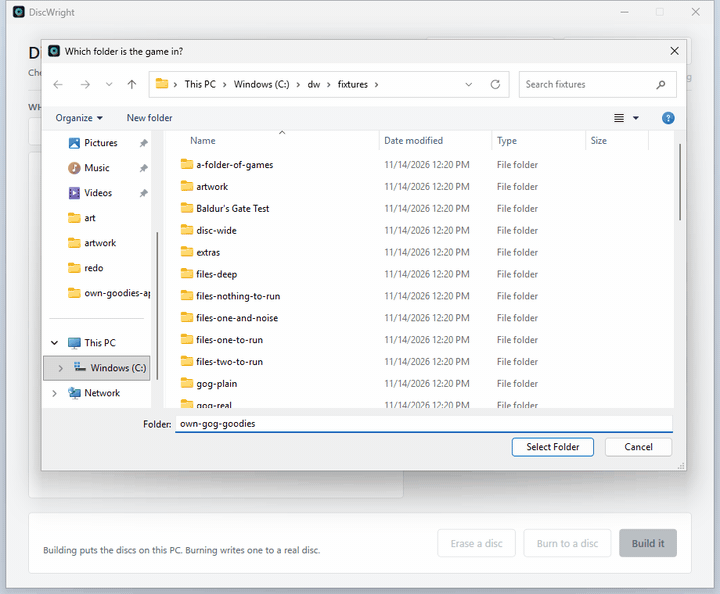
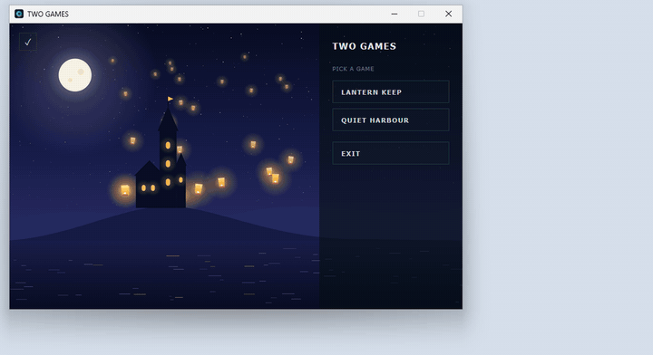
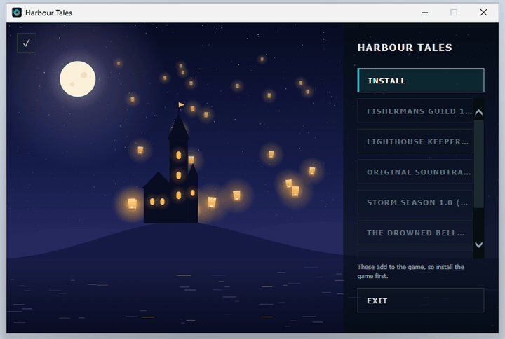

DiscWright 2.0.4 gives every game on a disc its own manual and extras, and makes a game with a lot of add-ons fit in its menu. Both were asked for: the first by xniwo and by LegendsAlwaysLive on Reddit, the second by LegendsAlwaysLive. Thank you both.

DiscWright is on the [Microsoft Store](https://apps.microsoft.com/detail/9NS2FK1N3KKC) now too. The Store copy gets 2.0.4 through the Store, once Microsoft has checked it.

## Updating

From 2.0.1, 2.0.2 or 2.0.3, press **Check for new version** under the app's name, then **Update to 2.0.4**. From 2.0.0, download the setup below and run it; it installs over 2.0.0 in the same place.

## Download

- **DiscWright-2.0.4-setup.exe** installs it for you alone, with no administrator prompt, and adds it to the Start menu.
- **DiscWright-2.0.4-portable.exe** is the same app as one file. Put it anywhere and double-click it.
- **SHA256SUMS.txt** has the checksum of both, for `sha256sum -c`.

Windows 10 or 11, 64-bit. Nothing else needs installing.

**Windows will say "Windows protected your PC" the first time** you run a download from here. DiscWright is not code signed yet, so SmartScreen does not know it. Press More info, then Run anyway. The Store copy is signed by Microsoft and opens without it.

With winget, `winget upgrade DiscWright.DiscWright` once this version reaches it.

## What is new

**Each game has its own manual and extras.** On a disc of several games, every game used to share one Manual and one Extras. Now, when you add a game, DiscWright asks about each thing beside its installer: the game's manual, one of its extras, an add-on, or just copied beside the installer with no button. It suggests the likely answer for each, so usually you only press **Put these on too**. Games added together can be answered once for all of them.

In the list, each game shows its own **Manual** and **Extras**, a file can be swapped between the two with one click, and **Add a manual** and **Add extras** under the list add more from anywhere for the game you picked.

**On the disc, each game's screen opens its own.** Manual opens the game's manual, or its folder when there are several. Extras opens the game's extras. The list of games keeps a Manual and Extras of the disc's own, if you add any. A game split across a set of discs carries its manual and extras on every disc of the set.

**A game with many add-ons fits in its menu.** A base game with seven DLC pushed Manual and Exit off the bottom of the menu with no way to scroll. The add-ons scroll on their own now, and Manual, Extras, Back and Exit stay where they are under them.

**Add-on buttons drop the game's name.** GOG names every DLC after its game, so seven buttons all read "HARBOUR TALES - TH...". Each button now shows only what the add-on adds, and pointing at it shows the full name.

**The menu says why an add-on is grey.** Under the add-ons, a line says "These add to the game, so install the game first." until the game is installed.

The menu changes are on discs built with 2.0.4. A disc you already burned keeps the menu it was built with.

**Fixed on the way:**

- **None of them** answered for every game added together also kept their updates off the disc. It used to leave the later games' updates on.
- **Add extras** picks one folder at a time. Windows' folder picker refuses several, so asking for several did nothing.
- The total under the list counts every file in a game's own Manual and Extras folders.

## Checked how

The suite is 2025 tests, run on every change. Every disc in this release's pictures was built by 2.0.4 and opened from its own image on a clean Windows 11 machine. A disc of three games, each with its own manual and extras, was burned on a real DVD-R, read back file by file, and every Manual and Extras on its menu opened the right thing.
