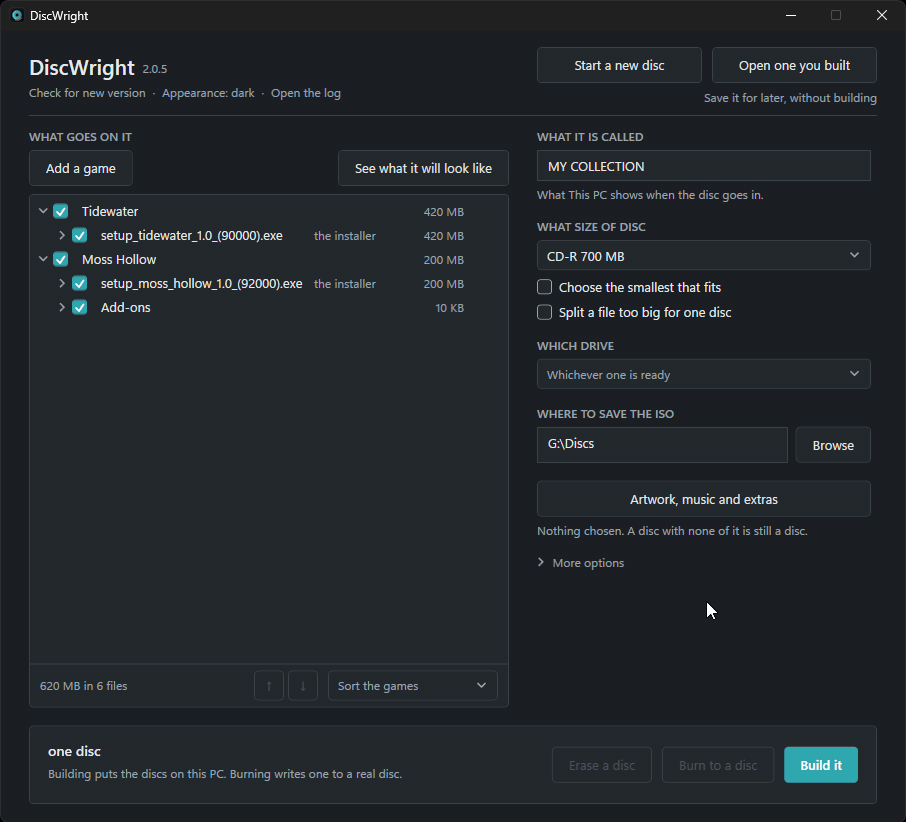
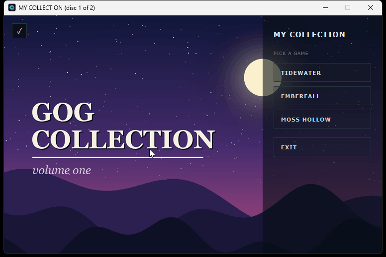
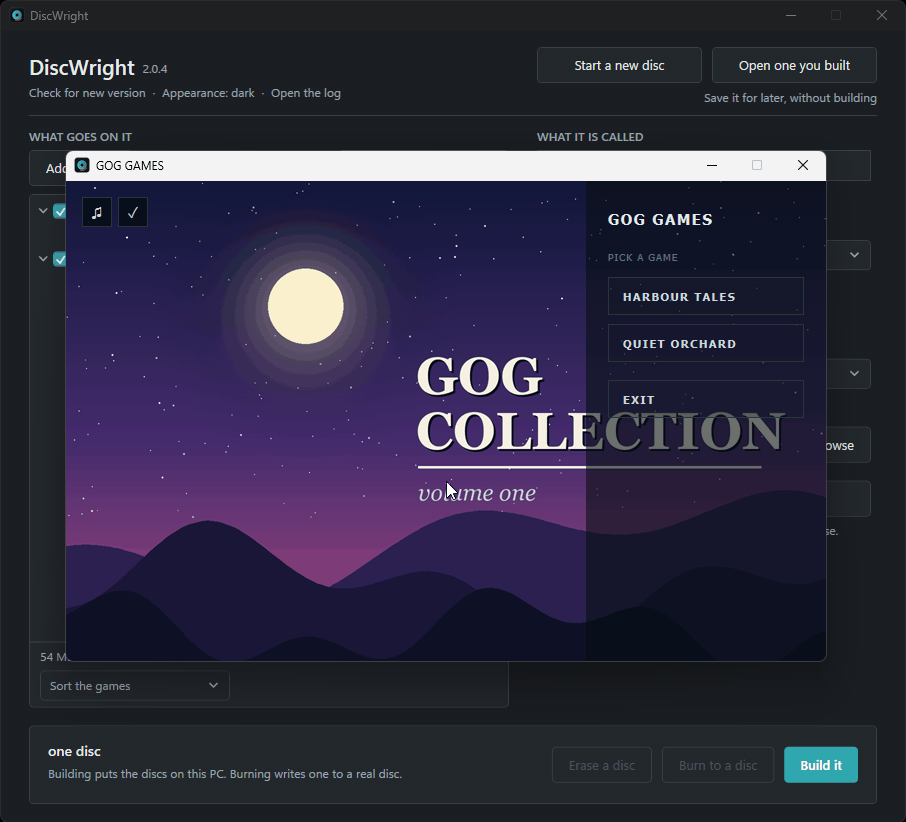
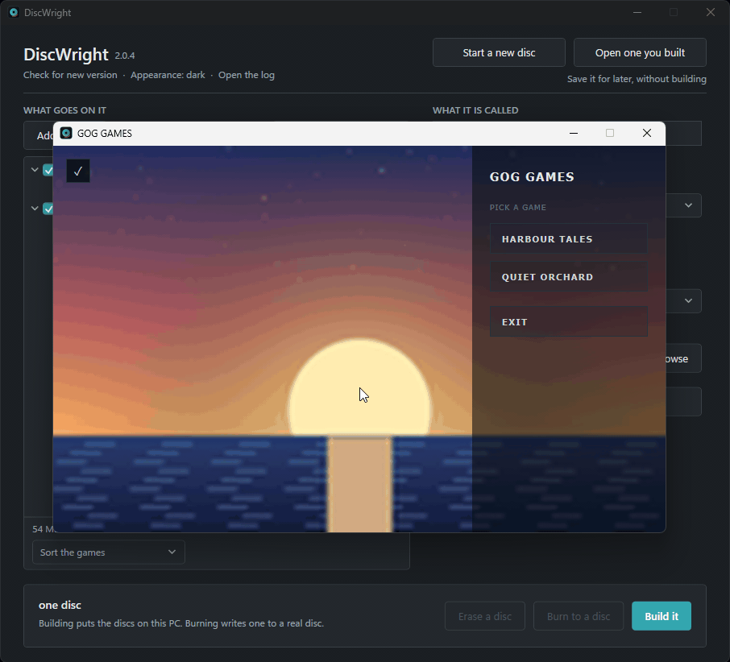
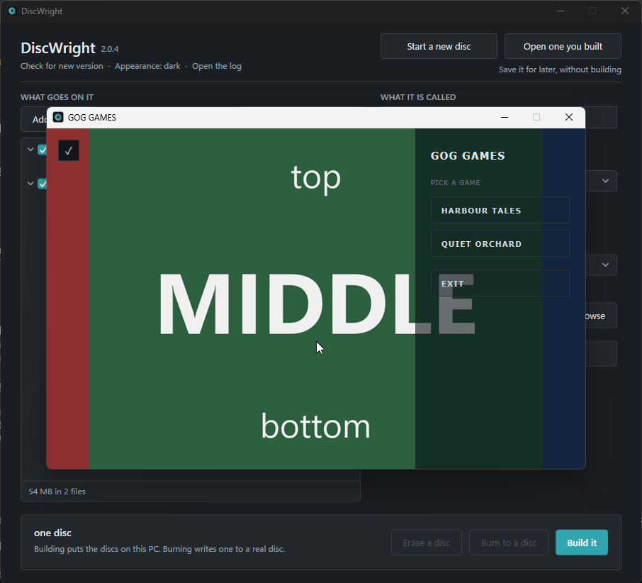
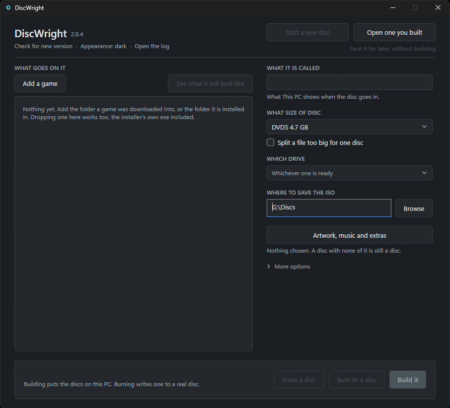
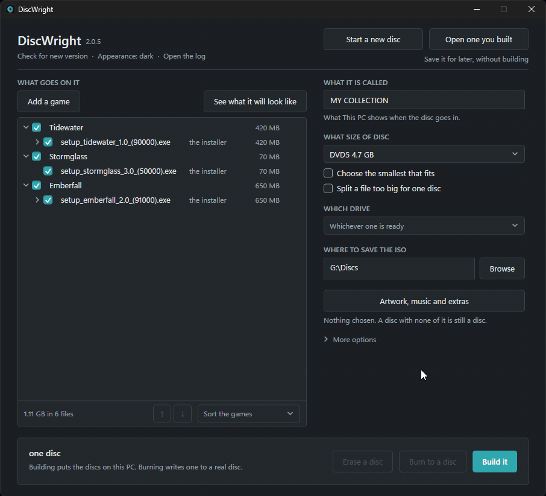
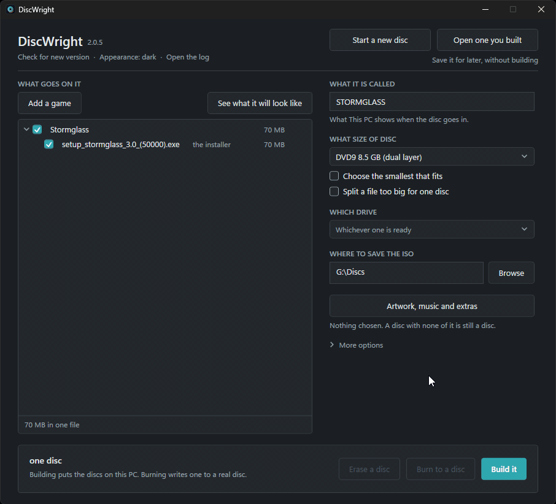
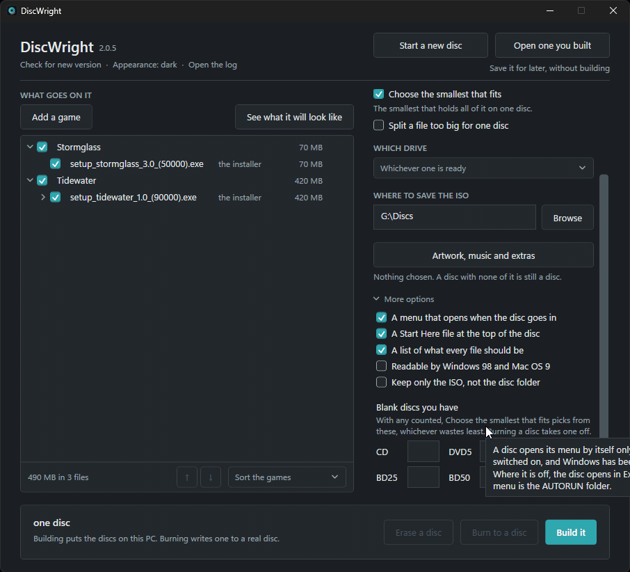
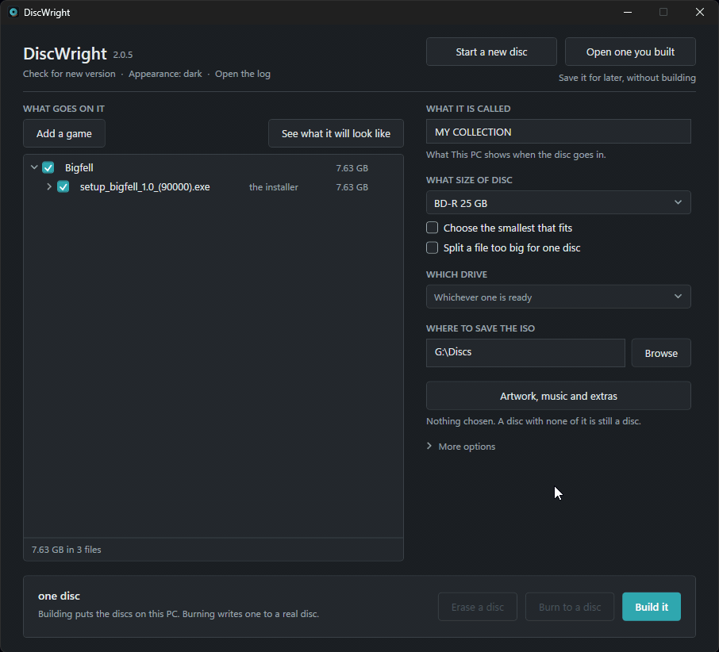

DiscWright 2.0.5 puts several games that do not fit on one disc onto one set, with every game on every disc's menu, and gives the menu a look you can choose: where the list sits, the font, the colour, the frame and how the background fits. Much of it was asked for. Thank you to [xniwo](https://github.com/xniwo) on GitHub, whose notes in [#98](https://github.com/lazardjokovic/discwright/issues/98) are behind most of the menu options, the blank disc counts and the ISO only build, and to a reader on Reddit, who found the add-on mix ups and asked to choose which part of a background is kept.

The copy from the [Microsoft Store](https://apps.microsoft.com/detail/9NS2FK1N3KKC) gets 2.0.5 through the Store, once Microsoft has checked it.

## Updating

From 2.0.1 or later, press **Check for new version** under the app's name, then **Update to 2.0.5**. From 2.0.0, download the setup below and run it. It installs over 2.0.0 in the same place.

## Download

- **DiscWright-2.0.5-setup.exe** installs it for you alone, with no administrator prompt, and adds it to the Start menu.
- **DiscWright-2.0.5-portable.exe** is the same app as one file. Put it anywhere and double-click it.
- **SHA256SUMS.txt** has the checksum of both, for `sha256sum -c`.

Windows 10 or 11, 64-bit. Nothing else needs installing.

**Windows will say "Windows protected your PC" the first time** you run a download from here. DiscWright is not code signed yet, so SmartScreen does not know it. Press More info, then Run anyway. The Store copy is signed by Microsoft and opens without it.

With winget, `winget upgrade DiscWright.DiscWright` once this version reaches it.

## One thing that works differently now

**Several games that do not fit on one disc used to get a disc each. Now they share one set.** A project of several games saved by 2.0.4 builds as one set when you build it again, in the same folder, and the earlier build's folders are removed once the new one is finished. The window asks first. To get a disc for each game as before, tick **Give each game a disc of its own**.

## What is new

### Several games on one set

**Games fill the discs in the order of your list.** Three games that come to two and a half discs take three discs, where 2.0.4 gave each game a disc or a set of its own and could take five. Before anything is built the window says which game lands on which disc, for example "Disc 1: Tidewater, Emberfall. Disc 2: Emberfall, Moss Hollow." Drag a game to another place and the line follows.

**Every disc's menu lists every game.** What a game's button does depends on where the game is:

- All on the disc in the drive: **Install**, straight from the disc.
- All on another disc: **Install from disc 3**. It asks for that disc and carries on by itself once it is in.
- Spread over discs: **Install from 2 discs**. It copies that game off its discs, puts it back together and installs it from there, as a set always did.

**The menu checks which disc is really in the drive** before it copies or starts anything, so a disc swapped by hand while the menu is open is noticed.

**Remove the copy is offered whenever it is there.** After a game from a set is installed, the copy on the hard drive is no longer needed. The button to remove it used to show only in the moment after installing. Now it shows whenever the game is installed and the copy is still there.

### The look of the menu

- **The list can sit on the left**, so it does not cover a logo on the right of your background.
- **The disc's manual and extras can be small buttons in the corner** instead of rows in the list, and one more small button opens the disc in Explorer.
- **The main menu can have a heading of its own**, or none.
- **The font and the colour of the text can be chosen**, and the menu can use a font file of your own.
- **The menu can have no window frame.**
- **A background can be filled, fitted, stretched or tiled**, and you choose which part of a picture is kept when it is cropped.
- **FLAC** can be chosen for the menu's music.

### Adding games and add-ons

- **An add-on kept in another folder can be attached to its game.**
- **The game is the installer with the most behind it**, so a DLC beside the base game is no longer taken for the game. Two versions of one game in a folder are told apart.
- **An add-on carries its parts**, the numbered files beside its installer.
- **An installer and its parts are one row with one tick.** Open the row to see the parts.
- **The empty list says how folders work**: each game needs a folder of its own, and adding their parent folder brings them all in at once.
- **Drag a game to move it**, use the arrows, or sort the list by name. An add-on can be dragged too, and updates run in build order.

### Sizes and blank discs

- **Choose the smallest that fits** picks the size of disc for you, and moves it up when you add more.
- **Blank discs you have**: count your blanks under More options, and the window says when a build takes more of a size than you have.

### Building

- **Building over an earlier disc is asked about first**, and what the earlier build left is removed when the new one is finished.
- **A build can be stopped.** Stop asks first, then deletes what the build had written.
- **A build asks first when the drive has no room for it**, with the figures.
- **Keep only the ISO** deletes the disc folder once the image is made.
- **The progress line names the game** when games get discs of their own, and says which disc's image is being written.

## Fixed

- A preview of a set said its list of files was missing. It shows what the real disc will.
- A stray file beside a folder of games made Extras buttons that opened nothing.
- The result of the disc check could run off the bottom of the menu.
- The disc check failed on file names with unusual characters.
- A set built without the list of what every file should be could not be installed.
- A cut file that would not go back together left the Install button dead until the menu was opened again.
- A folder of game files that came on a set could not save once copied.
- Add-ons stayed grey after their game was installed from a set, until the menu was opened again.
- The close button of a menu with no frame sat over the first row of the list.
- Long words on a menu button were cut off, "Remove the copy, 650 MB" among them. The letters draw closer to fit.
- What one game's screen said stayed under the list of games, and under the next game, after Back.
