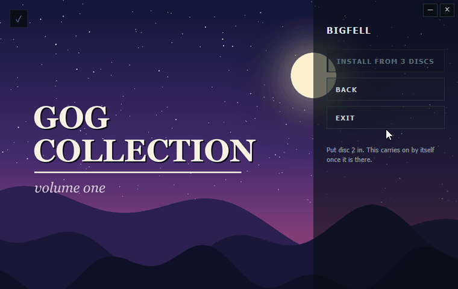
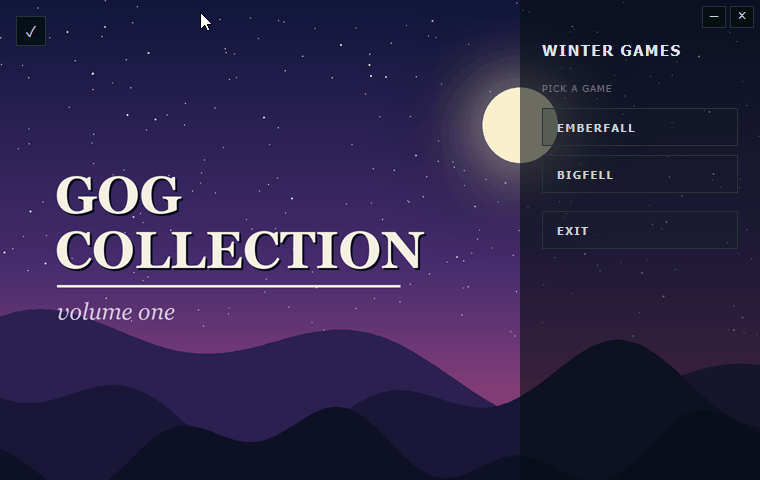
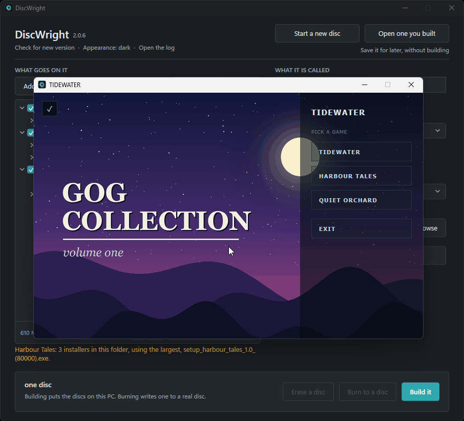
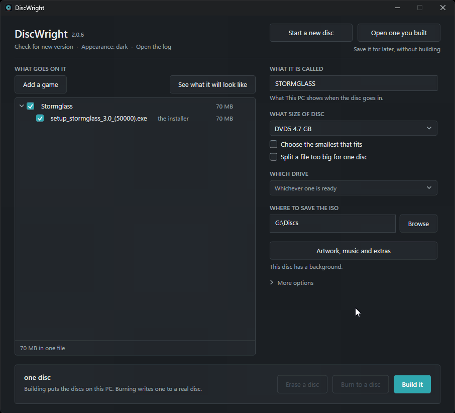
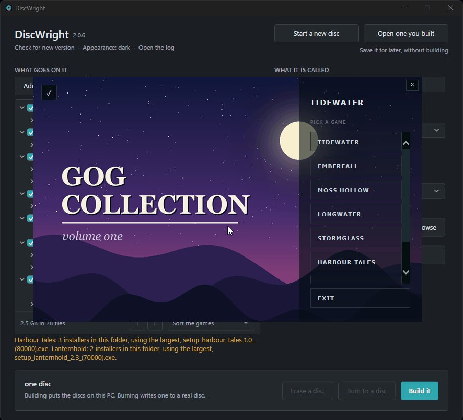

DiscWright 2.0.6 lets a set's copy be stopped and a menu with no frame be minimised, gives the menu's text a size and any colour you like, puts each game's manual on disc 1 of a set, lets an orange line be put aside once read, and fixes a disc image that failed on long file paths and a menu with no frame that would not scroll. Thank you to [xniwo](https://github.com/xniwo) on GitHub, whose notes in [#98](https://github.com/lazardjokovic/discwright/issues/98) are behind most of it, and to a reader on Reddit, who found the long path fault with a game's soundtrack.

The copy from the [Microsoft Store](https://apps.microsoft.com/detail/9NS2FK1N3KKC) gets 2.0.6 through the Store, once Microsoft has checked it.

## Updating

From 2.0.1 or later, press **Check for new version** under the app's name, then **Update to 2.0.6**. From 2.0.0, download the setup below and run it. It installs over 2.0.0 in the same place.

## Download

- **DiscWright-2.0.6-setup.exe** installs it for you alone, with no administrator prompt, and adds it to the Start menu.
- **DiscWright-2.0.6-portable.exe** is the same app as one file. Put it anywhere and double-click it.
- **SHA256SUMS.txt** has the checksum of both, for `sha256sum -c`.

Windows 10 or 11, 64-bit. Nothing else needs installing.

**Windows will say "Windows protected your PC" the first time** you run a download from here. DiscWright is not code signed yet, so SmartScreen does not know it. Press More info, then Run anyway. The Store copy is signed by Microsoft and opens without it.

With winget, `winget upgrade DiscWright.DiscWright` once this version reaches it.

## One thing that works differently now

**On a disc of several games, a game's screen offers only its own manual and extras.** A game with none of its own used to show the disc's manual and extras on its screen, under buttons that looked like the game's. The disc's own are on the main menu, a press away. A disc of one game is unchanged.

**On a set of several discs, each game's own manual and extras go on disc 1 when there is room.** Disc 1 is where you go through the games and choose one, so its manual opens right there instead of asking for the last disc. Every game's installer stays on exactly the discs it was on before, and when disc 1 is full they go on the game's own first disc instead.

## What is new

- **Stop, while a set copies its discs.** Install carries on from what was copied. The file it was in the middle of is taken away, so nothing half copied is ever installed from, and closing the menu part way does the same.
- **Minimise, on a menu with no frame.** A button beside the close button puts the menu out of the way, and its button on the taskbar brings it back where it was.
- **Text size.** Smaller, As it is, Larger or Largest, for the menu's heading and buttons. The largest is as large as a button has room for, and a long name is still drawn closer to fit.
- **Any colour.** A rainbow swatch at the end of each row of colours opens Windows' own colour dialog, starting at the colour in the box, and fills the box with what you pick.
- **The small picture shows the menu's words**, in the text colour, the font and on the side chosen, as you change them.
- **A small cross at the end of each orange line** hides it once you have read it. It comes back when it has something different to say, and Start a new disc brings them all back.
- **A GOG manual that comes zipped**, such as `deadspace_manual.zip`, is offered as the game's manual rather than as an extra.

## Fixed

- **A disc image failed when a file's full path was longer than 260 characters**, with "The system cannot find the path specified", and the window blamed a full drive. A game's soundtrack or extras in deep folders, built to a folder on the Desktop, was enough. The image is now made however deep the paths go.
- **A menu with no frame could not scroll its list of games.** A press on the scrollbar was taken as moving the window.
- Right after a burn, the line under the disc size said in orange that the disc in the drive was read only, about the disc that had just been written. It says nothing about that disc now until it comes out.
- A press on a Manual or Extras button with nothing behind it could open the top of the disc. It opens nothing.
- On a menu with no frame and its list on the left, the close button sat on top of the small buttons.
- With a very long heading at a large text size, the disc check's result was cut through the middle of a line.

